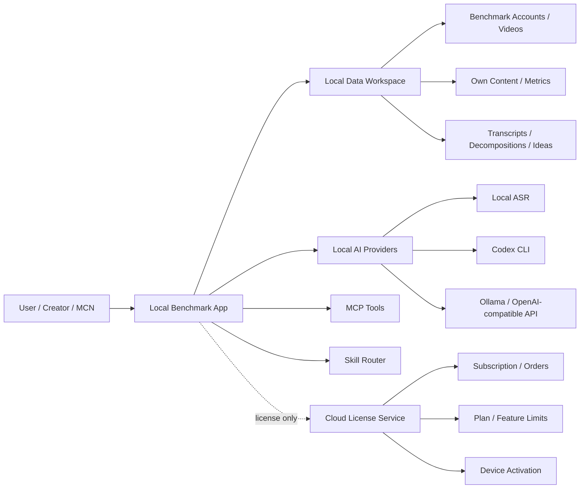

# Commercial Benchmark OS Design

## Product Positioning

This product should be sold as a local-first content decision system, not as a generic AI analysis tool.

Core promise:

> Turn daily benchmark accounts, videos, transcripts, comments, and publishing results into executable content decisions.

The paid value is not "AI can analyze content". The paid value is:

- collect scattered benchmark data into a stable local workspace
- decompose videos and accounts into repeatable content patterns
- compare competitors with the user's own content performance
- turn observations into topics, scripts, publishing plans, and review decisions
- keep sensitive platform cookies, media, transcripts, and AI outputs local

## Product Shape

The commercial product should have four layers:

1. Local desktop or local web app
2. Local AI and data processing services
3. MCP and Skill interface for agent usage
4. Cloud license and entitlement service

The local app is the real paid product. MCP and Skill are entry points. The cloud service should only manage commercial state, not user content data.

## Local vs Cloud Boundary

Local-only data:

- platform cookies
- scraped benchmark data
- downloaded videos and audio
- transcripts
- AI decomposition outputs
- user account metrics
- drafts, scripts, publishing plans

Cloud-managed data:

- user identity
- subscription plan
- license key
- activated devices
- feature entitlements
- app version and rule-pack version
- optional anonymized crash or usage events, only after explicit consent

This boundary is important for sales. Users can believe the product because the riskiest data never leaves their machine.

## Paid Capability Model

Charge by decision power and scale, not by AI tokens.

Free:

- 3 benchmark accounts
- basic account sync
- basic video list and metrics
- manual single-video decomposition
- local data export

Personal:

- 30 benchmark accounts
- batch transcript generation
- account positioning decomposition
- viral video structure decomposition
- topic opportunity radar
- local AI provider configuration

Pro:

- 100 benchmark accounts
- batch account and video analysis
- own-content review against benchmark library
- content gap detection
- weekly topic plan generation
- publishing recommendation
- premium decomposition templates

Team:

- multiple seats
- shared benchmark library
- shared templates and rules
- device and license management
- team-level reporting
- priority support

## First Commercial Workflow

The first paid workflow should be:

1. Add benchmark accounts.
2. Sync recent videos and metrics.
3. Transcribe selected videos locally.
4. Decompose videos into hooks, structure, selling points, emotion, audience, and topic pattern.
5. Compare benchmark patterns with user's own videos.
6. Generate actionable decisions:
   - topics worth doing
   - topics to avoid
   - opening angle suggestions
   - account positioning gap
   - next 7-day publishing plan

This workflow is better than selling a generic "analyze this video" feature because it creates a loop. Users pay for repeated decisions, not one-off summaries.

## Core Product Modules

Benchmark Library:

- manages competitor accounts
- syncs account and video metrics
- stores local snapshots
- tracks growth and changes over time

Decomposition Engine:

- turns video, transcript, metadata, and metrics into structured fields
- supports different decomposition templates by industry
- produces comparable records, not loose prose

Opportunity Radar:

- finds repeated high-performing patterns
- detects content gaps
- ranks topics by relevance, evidence strength, and production difficulty

Own Content Review:

- imports or records the user's own video metrics
- compares user's content against benchmark patterns
- identifies weak hooks, mismatched topics, and positioning drift

Decision Composer:

- converts analysis records into action plans
- outputs topic cards, script briefs, and publishing plans
- keeps evidence links back to original benchmark videos

License Client:

- activates a device
- refreshes signed license files
- enforces local feature limits
- supports offline grace periods

MCP Server:

- exposes local product capabilities to Codex, Claude, Cursor, and other agents
- does not contain the full business logic

Skill Pack:

- teaches agents when to call MCP tools
- routes user intent into workflows
- should be treated as a workflow layer, not the protected product itself

## Suggested MCP Tools

benchmark.add_account:

- input: platform, account_url, tags
- output: account_id, sync_status

benchmark.sync:

- input: account_ids, limit, since
- output: synced_accounts, new_videos, updated_videos

benchmark.top_videos:

- input: account_ids, metric, time_window, limit
- output: ranked video list

content.transcribe:

- input: video_ids, provider, language
- output: transcript ids and status

content.decompose:

- input: video_ids, template_id
- output: structured decomposition records

radar.generate:

- input: niche, account_ids, time_window, goal
- output: topic opportunities and evidence

own.review:

- input: own_video_ids, benchmark_scope
- output: gaps, strengths, recommended next actions

plan.compose:

- input: radar_id, days, publishing_capacity
- output: topic plan and script briefs

license.status:

- input: none
- output: plan, limits, expiration, offline_grace_remaining

## Skill Design

The commercial Skill should be a router and workflow guide.

Recommended top-level commands:

- `/benchmark` for competitor account and video analysis
- `/radar` for topic opportunity discovery
- `/review` for own-content review
- `/plan` for publishing plan generation

The Skill should not contain private decomposition rules in full. It should call the local MCP server, and the MCP server should execute templates stored inside the licensed local app.

## Licensing Design

Use subscription license with signed local license file.

Activation flow:

1. User logs in or enters license key.
2. Local app creates a device fingerprint.
3. Cloud returns a signed license file.
4. Local app validates signature with embedded public key.
5. Local app refreshes license periodically.
6. If offline, paid features continue within a grace period.

Recommended rules:

- 7 to 14 day offline grace period
- never lock the user's local data
- when expired, disable paid analysis, batch jobs, premium templates, and increased limits
- allow export even after expiration
- limit devices per plan

## Implementation Phases

Phase 1: Productize the local app

- define feature gates and plan limits
- add local license status model
- add AI provider abstraction
- normalize decomposition outputs into comparable records
- add decision cards and evidence links

Phase 2: Add paid licensing

- build minimal cloud license API
- implement device activation
- implement signed license validation
- add local offline grace behavior
- add admin tools for plans and devices

Phase 3: Add MCP and Skill

- expose stable MCP tools around existing local capabilities
- create the routing Skill
- keep private templates inside the licensed app
- test workflows from Codex or other MCP clients

Phase 4: Package and sell

- package as local desktop app or one-click local service
- add update channel
- add template marketplace later only if user demand is clear
- create onboarding around the first benchmark workflow

## Non-goals

- do not build full multi-tenant SaaS first
- do not upload raw competitor or user content to the cloud by default
- do not sell a prompt pack as the main product
- do not make MCP the only product surface
- do not rely on obfuscation as the main protection mechanism

## Key Architecture Decision

Start as a modular monolith.

Reason:

- current codebase is already a local Flask and Vue application
- the team is likely small
- local data consistency matters more than independent service deployment
- product-market iteration is more important than distributed infrastructure

Suggested module boundaries:

- `benchmark`
- `transcription`
- `analysis`
- `radar`
- `own_review`
- `publishing`
- `licensing`
- `ai_providers`
- `mcp`
- `storage`

The first refactor should not split services. It should split responsibilities inside the local app.
